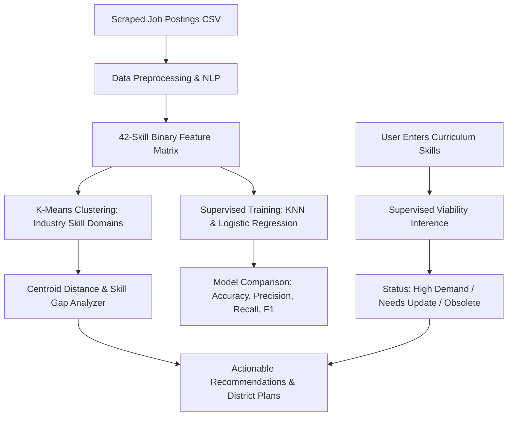

# 🏛️ Labour-Market Intelligence & Curriculum-Alignment Platform
### Developed for MSINS Problem Statement ID26134
**Government of Maharashtra · Maharashtra State Innovation Society (MSINS)**  
*Department of Skills, Employment, Entrepreneurship and Innovation*

---

## 📌 Problem Statement Overview (ID26134)

- **Title**: Challenges in aligning skill development programs with industry requirements and emerging job market demands.
- **Context & Need**: Skill development programs have historically relied on broad, outdated occupational categories that lag behind changing technology cycles, local employer expectations, and regional productivity benchmarks. Course curricula, trainer capacity, and lab equipment often fall out of sync with emerging market signals, leading to lower placement rates and employer-candidate mismatches.
- **The Solution**: An evidence-based **Labour-Market Intelligence and Curriculum-Alignment Platform** that ingests job postings, uses **Unsupervised Learning (K-Means)** to cluster skill demand into emerging industry sectors, applies **Supervised Learning (KNN & Logistic Regression)** to predict course viability (`High Demand`, `Needs Update`, `Obsolete/Oversupplied`), generates actionable curriculum update plans with faculty and equipment guidance, and produces district-level capacity training plans across Maharashtra.

---

## 🚀 Key Functional Modules

| Module | Purpose & Machine Learning Methodology |
|---|---|
| **1. Universal Dataset Ingestion** | Ingests job postings CSV with columns: `Job Role`, `Required Skills`, `District/Location`, `Demand Volume`. Intelligent fuzzy mapping supports Kaggle, LinkedIn, and custom web scrapers. |
| **2. Unsupervised Learning (K-Means)** | Clusters technical competency vectors into distinct industry domains (e.g. *Cloud, DevOps & Distributed Systems*, *Data Science & Applied AI*, *Modern Fullstack*, *Enterprise Backend*). |
| **3. Supervised Learning (KNN & Logistic Regression)** | Evaluates course viability given an input syllabus. Predicts status: **`High Demand`**, **`Needs Update`**, or **`Obsolete/Oversupplied`** with full posterior probabilities and confidence metrics. |
| **4. Model Evaluation & Comparison** | Generates comparison table with **Accuracy, Precision, Recall, and F1-Score (Weighted)**, per-class metrics breakdowns, and designates the winning model. |
| **5. Evidence-Based Gap Recommendations** | Maps input curriculum to the nearest industry cluster centroid, flags critical missing skills, estimates placement readiness (%), and provides equipment/trainer upskilling roadmaps. |
| **6. Maharashtra District Intelligence** | Aggregates hiring demand volume, dominant skills, and high-demand roles across districts (Pune, Mumbai, Nagpur, Nashik, Thane, Chhatrapati Sambhajinagar, Kolhapur, Solapur). |

---

## 🏗️ System Architecture & Directory Structure

```
career_trend_analysis/
│
├── README.md                          ← Platform documentation & MSINS compliance (this file)
├── requirements.txt                   ← Python dependencies
│
├── flask_app/                         ← Production Web Application (Port 5000)
│   ├── app.py                         ← Flask backend, ML pipelines (K-Means, KNN, LR), analytics APIs
│   ├── sample_jobs.csv                ← 400-record Maharashtra job market dataset
│   ├── static/
│   │   └── style.css                  ← Dark-mode modern UI, MSINS branding, responsive glassmorphism
│   └── templates/
│       └── index.html                 ← Semantic HTML5 dashboard with Vanilla JS engine
│
└── app.py                             ← Streamlit implementation (Port 8501)
```

---

## ⚙️ How It Works (Step-by-Step Pipeline)



### 1. Ingestion & Preprocessing
- Regex word boundaries extract canonical skills and aliases (`k8s` $\to$ `kubernetes`, `cicd` $\to$ `ci/cd`, `infosec` $\to$ `cybersecurity`).
- One-hot binary vectors $\mathbf{x} \in \{0, 1\}^{42}$ represent presence or absence of core competencies.
- Universal header resolution maps diverse CSV column names automatically.

### 2. Unsupervised K-Means Skill Demand Clusters
- Partitions technical skill vectors into distinct technology archetypes:
  $$\arg\min_S \sum_{i=1}^{k} \sum_{\mathbf{x} \in S_i} \|\mathbf{x} - \boldsymbol{\mu}_i\|^2$$
- Discovers emerging domains:
  - **Cluster 1**: Cloud, DevOps & Distributed Systems (`aws`, `docker`, `kubernetes`, `linux`, `ci/cd`, `git`)
  - **Cluster 2**: Data Science, Analytics & Applied AI (`python`, `pytorch`, `tensorflow`, `sql`, `deep learning`)
  - **Cluster 3**: Modern Fullstack & Web Platforms (`javascript`, `react`, `node.js`, `mongodb`, `typescript`)
  - **Cluster 4**: Enterprise Systems & Backend (`java`, `postgresql`, `redis`, `sql`, `fastapi`)

### 3. Supervised Course Viability Prediction (KNN vs. Logistic Regression)
- **Target Variable**: `curriculum_status` $\in \{\text{"High Demand"}, \text{"Needs Update"}, \text{"Obsolete/Oversupplied"}\}$.
- **K-Nearest Neighbors ($k=5$)**: Classifies course viability based on proximity in standardized feature space to current hiring requirements.
- **Multinomial Logistic Regression**: Models class probabilities using balanced loss weighting:
  $$P(y = c \mid \mathbf{x}) = \frac{e^{\mathbf{w}_c^T \mathbf{x} + b_c}}{\sum_{j=1}^{C} e^{\mathbf{w}_j^T \mathbf{x} + b_j}}$$
- **Evaluation**: Computes Accuracy, Weighted Precision, Weighted Recall, and Weighted F1-score with stratified cross-validation.

### 4. Curriculum Gap & Actionable Recommendations
- Evaluates cosine distance between candidate curriculum vector and K-Means cluster centroids:
  $$\text{Cosine Similarity} = \frac{\mathbf{x}_{\text{curriculum}} \cdot \boldsymbol{\mu}_{\text{cluster}}}{\|\mathbf{x}_{\text{curriculum}}\| \|\boldsymbol{\mu}_{\text{cluster}}\|}$$
- Identifies **Matched Skills** (competencies already covered in course).
- Identifies **Critical Missing Skills** (gaps that need immediate inclusion).
- Generates **Trainer Capacity Planning** and **Equipment/Lab Guidance**.
- Recommends **Priority Maharashtra District Corridors** (e.g., Pune Hinjewadi, Mumbai BKC, Nagpur MIHAN).

---

## 🏃 Quick Start Guide

### 1. Installation
Clone the repository and install required packages:
```bash
git clone https://github.com/Allen-viju-369/career-trend-analysis.git
cd career_trend_analysis
pip install -r requirements.txt
```

### 2. Run Flask Web Application
```bash
cd flask_app
python app.py
```
Open **`http://localhost:5000`** in your browser.

### 3. Workflow on the Dashboard
1. Click **`🚀 Quick Load Maharashtra MSINS Dataset (400 Roles)`** or upload your own CSV.
2. View **District Training & Capacity Intelligence** for Maharashtra.
3. Review **Top Emerging Industry Roles** and **K-Means Skill Clusters**.
4. Compare model benchmarks in the **Supervised Model Comparison** table.
5. In **Course Curriculum Viability Analyzer**, select syllabus skills (e.g. `docker`, `kubernetes`, `aws`) and click **`⚡ Evaluate Curriculum Viability & Detect Skill Gaps`**.
6. Review the viability verdict, missing competencies, lab equipment guidance, and district placement corridors.

---

## 📊 Dataset Specification (`sample_jobs.csv`)

The platform accepts CSV datasets with the following fields:

| Field Name | Accepted Aliases | Description |
|---|---|---|
| `Job Role` | `job_role`, `job_title`, `title`, `role`, `qualification` | Emerging job designation or occupation |
| `Required Skills` | `required_skills`, `skills_raw`, `skills`, `competencies` | Comma-separated technical tools & skills |
| `District/Location` | `district`, `location`, `city`, `region` | Maharashtra district (Pune, Mumbai, Nagpur, etc.) |
| `Demand Volume` | `demand_volume`, `openings`, `vacancies`, `count` | Live hiring demand / number of vacancies |
| `Curriculum Status` | `curriculum_status`, `status`, `viability` | High Demand, Needs Update, or Obsolete/Oversupplied |

---

## 📜 Alignment with MSINS ID26134 Outcomes

- ✅ **Continuous Evidence-Based Mechanism**: Ingests real hiring signals rather than relying on static historical surveys.
- ✅ **Curriculum Revision Guidance**: Pinpoints exact modules to add (e.g., Docker, Kubernetes, CI/CD) to elevate course viability.
- ✅ **Flagging Obsolete Courses**: Accurately flags legacy stacks (e.g., desktop/HTML-only programs) with low placement potential.
- ✅ **District-Level Capacity Planning**: Aggregates local demand for Pune, Mumbai, Nagpur, Nashik, and other industrial clusters.
- ✅ **Trainer & Equipment Roadmaps**: Concrete equipment specs and faculty certifications needed for each domain.
